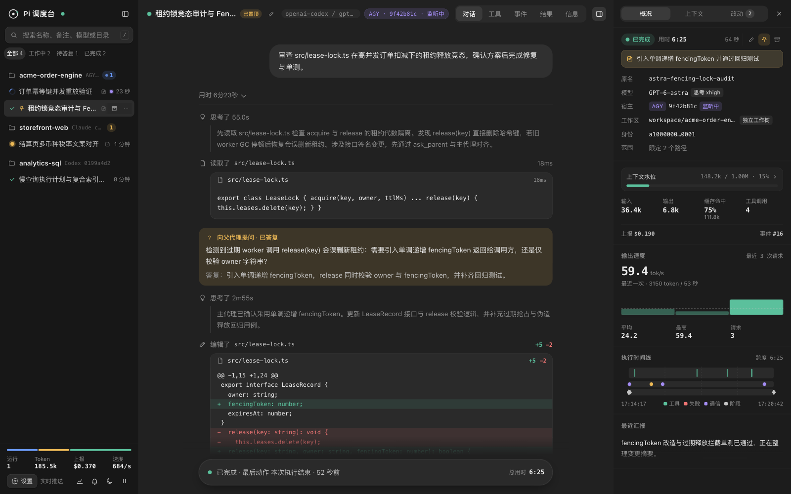
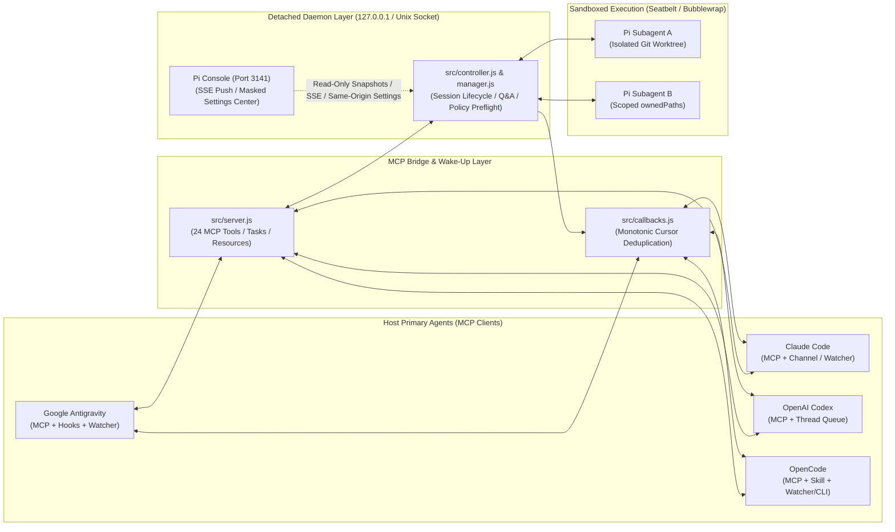
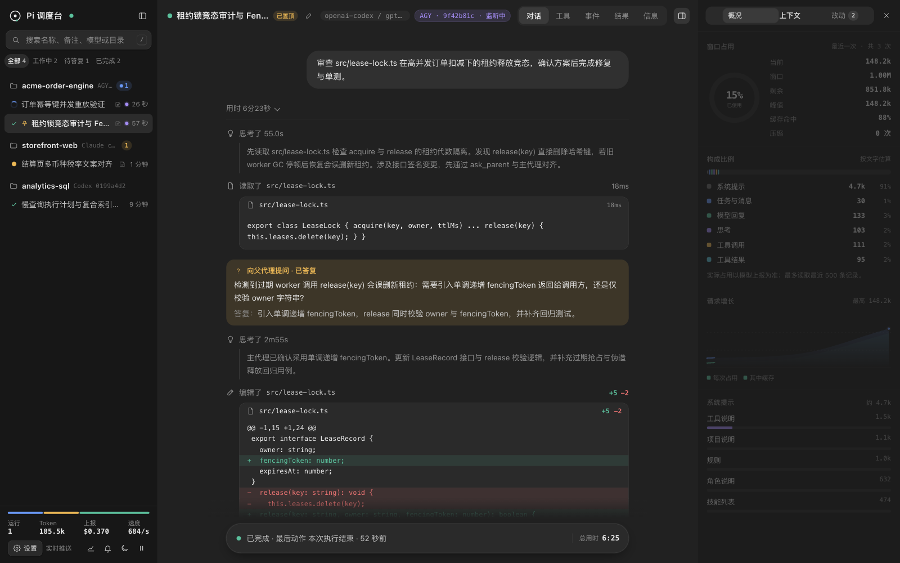
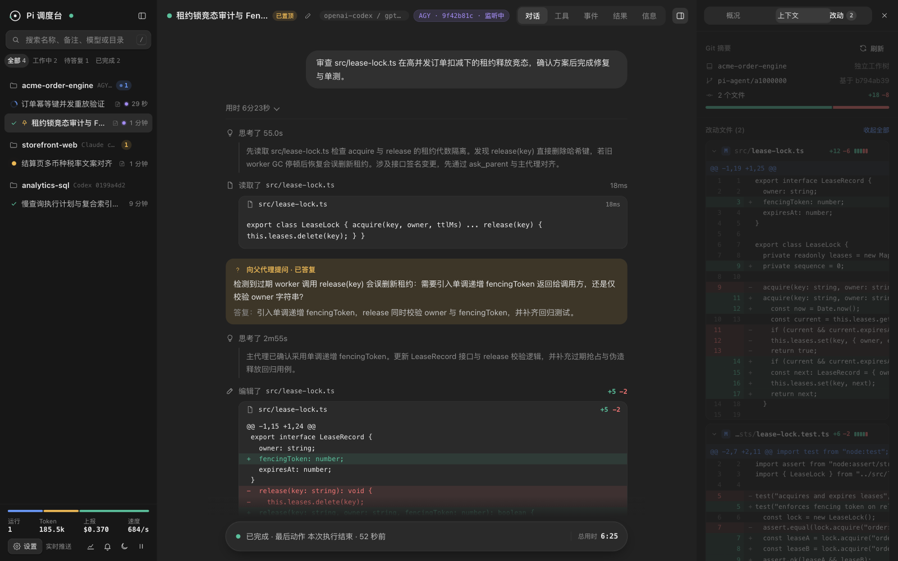
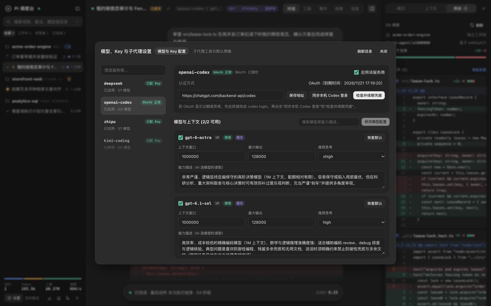

<div align="center">
  
  <h1>Pi Server</h1>
  <p><strong>Multi-Model Subagent Orchestration MCP & Real-Time Local Console for Antigravity, Claude Code, Codex, and OpenCode</strong></p>

  <p>
    <a href="https://github.com/paintstar/PI-Server/actions/workflows/ci.yml"></a>
    <a href="LICENSE"></a>
    = 22.19" />
    
    
  </p>

  <p>
    <a href="README.md">简体中文</a> · <strong>English</strong> · <a href="#quick-start">Quick Start</a> · <a href="#console-walkthrough">Screenshots</a> · <a href="#mcp-tool-reference-24-tools">MCP Tools</a> · <a href="docs/communication.md">Protocol & Sandbox</a>
  </p>
</div>

<p align="center">
  
</p>

---

**Pi Server** wraps your local [Pi Coding Agent](https://pi.dev) runtime into a host-agnostic Model Context Protocol (MCP) orchestration server paired with a dependency-free real-time web console (**Pi Dispatch Console** at `http://127.0.0.1:3141/`). Your primary agent decomposes work, selects models from structured capability profiles, and verifies results, while isolated Pi subagents execute tasks in dedicated Git worktrees under OS-level sandboxing (macOS Seatbelt / Linux & WSL2 `bubblewrap`)—with durable disconnect recovery, blocking parent Q&A, and native wake-up hooks.

## Key Highlights

- **Host-Agnostic Across Four Major AI IDEs/CLIs**: First-class installer and wake-up integration for **Google Antigravity** (bundled plugin, rules, skill, and `PreInvocation` / `Stop` hooks), **Claude Code** (`claude/channel` notifications and background event watcher), **OpenAI Codex** (`codex queue` thread delivery), and **OpenCode** (`opencode.jsonc` `mcp.servers` registration, bundled `SKILL.md`, session binding, background watcher, and opt-in CLI session wake-ups).
- **Detached Unix-Socket Controller**: Subagent processes and pending questions live inside an independent background daemon (`src/controller.js`). Closing or restarting your host chat never kills running Pi workers—reconnect anytime with `resume_agent`.
- **Durable Two-Way Messaging & Blocking `ask_parent`**: Subagents report milestones via `agent_message`, coordinate with sibling workers, or pause on ambiguity with `ask_parent` until explicitly answered via `reply_question`, backed by idempotent `requestId` / `messageId` receipts.
- **Real-Time Three-Pane Web Console (`127.0.0.1:3141`)**: Groups children by parent host session, streams live token-by-token reasoning and collapsible tool traces (`live.json` + SSE), visualizes 1M context window composition and `tok/s` throughput, renders read-only inline Git worktree diffs, and syncs session titles, notes, pins, and archives live with `organize_agents`.
- **Model Capability Profiles & Secret-Safe Settings Center**: Manage provider enablement, masked API keys, 1-click local Codex OAuth sync, 1M context window overrides, recommended thinking levels, and model capability descriptions from the UI (`0600` atomic backups before touching `~/.pi/agent/auth.json` or `models.json`).
- **Kernel-Enforced Cross-Platform Sandboxing (macOS Seatbelt / Linux & WSL2 `bubblewrap`)**: Restricts file writes to declared `ownedPaths` or isolated Git `worktree` branches while blocking access to `~/.pi`, `~/.codex`, `~/.ssh`, `~/.config/opencode`, `~/.local/share/opencode`, and controller state directories in `strict` and `dev` modes.
- **Read-Only Multi-Provider Quota Inspector**: Built-in `get_quota` queries plan windows and balances directly using local Pi credentials across Codex, Zhipu GLM / Z.ai, MiniMax Token Plan, DeepSeek, and OpenCode Go without mutating auth files or exposing account identities.

## Architecture



## Console Walkthrough

### 1. Context Window Telemetry & Growth Curve
Inspect per-request prompt occupancy (input + cache reads/writes), system prompt section breakdowns, and multi-turn growth against up to 1M-token windows.

<p align="center">
  
</p>

### 2. Read-Only Inline Git Worktree Diffs
Review exact file changes against each subagent's base commit directly inside the right-hand inspector or programmatically via `get_agent_changes` before merging.

<p align="center">
  
</p>

### 3. Model Profiles, 1M Context Overrides & Masked Credentials
Configure providers, sync local Codex OAuth tokens, adjust context windows, and author selection guidance read by parent agents via `get_model_profiles`—without ever exposing raw keys to the browser or MCP responses.

<p align="center">
  
</p>

## Quick Start

### Prerequisites

- **OS**: macOS (built-in `/usr/bin/sandbox-exec`) or Linux / Windows WSL2 (`sudo apt-get install -y bubblewrap`)
- **Node.js**: `>= 22.19.0`
- **Pi CLI**: `>= 1.0.2` (installed on `PATH` with at least one authenticated model provider)
- **Host Client**: Google Antigravity, Claude Code, OpenAI Codex, or OpenCode

### Installation

```bash
git clone https://github.com/paintstar/PI-Server.git
cd PI-Server

# 1. Install locked dependencies and run offline syntax + 100 sandbox/protocol tests
npm ci --ignore-scripts
npm run check
npm test

# 2. Register pi-server across installed Antigravity, Claude Code, Codex, and OpenCode clients
npm run install:all
```

Target individual hosts or remove integrations cleanly at any time (existing client configs are backed up with `0600` permissions under `.agents/records/config-backups/`):

```bash
npm run install:antigravity   # Builds & validates ~/.gemini/config/plugins/pi-server (--strict)
npm run install:claude        # Registers user-scope stdio MCP in ~/.claude.json
npm run install:codex         # Registers global MCP server in ~/.codex/config.toml
npm run install:opencode      # Registers local MCP in ~/.config/opencode/opencode.jsonc & installs SKILL.md

npm run uninstall:antigravity
npm run uninstall:claude
npm run uninstall:codex
npm run uninstall:opencode
```

Launch or attach to the local web console manually anytime:

```bash
npm run dashboard
# Open http://127.0.0.1:3141/
```

## Host Wake-Up & Session Binding

| Host | Session Binding | Asynchronous Wake-Up Mechanism |
| --- | --- | --- |
| **Google Antigravity** | Pass `antigravitySessionId` on `spawn_agent` or call `bind_session` | Bundled `PreInvocation` and `Stop` hooks inject undelivered events and guard against premature turn exit; pair with `mustWait.antigravityBackgroundCommand` (`node scripts/wait-events.js --session <id>`) for instant reactive wakeups, deduplicated via `antigravityDeliveredSeq`. |
| **Claude Code** | Auto-detected via `CLAUDE_CODE_SESSION_ID` | Emits `notifications/claude/channel` when started with `--dangerously-load-development-channels server:pi-server`, or wakes any session via background `npm run wait-events -- --agent <id>`. |
| **OpenAI Codex** | Pass `callback.codexThreadId` from `echo $CODEX_THREAD_ID` | Enqueues settle, question, failure, and limit events directly into the parent thread via `codex queue --thread <id>`. |
| **OpenCode** | Pass `opencodeSessionId` (or `parentSession: { kind: "opencode", sessionId }`), or call `bind_session(kind="opencode")` | Detects the `opencode` MCP client automatically, installs `~/.config/opencode/skills/pi-server/SKILL.md`, and supports `wait-events.js --session <id>` plus opt-in `opencodeCliWake` (`opencode run --session <id>`), deduplicated via the shared monotonic cursor. |

## MCP Tool Reference (24 Tools)

- **Lifecycle & Workspace (10)**: `spawn_agent`, `wait_agent`, `read_agent`, `send_message`, `set_agent_model`, `interrupt_agent`, `close_agent`, `resume_agent`, `list_agents`, `organize_agents`
- **Model Profiles, Health & Quota (4)**: `get_model_profiles`, `list_models`, `get_quota`, `get_subagent_health`
- **Durable Q&A, Callbacks & Diff Review (6)**: `reply_question`, `read_messages`, `ack_messages`, `bind_session`, `set_agent_callback`, `get_agent_changes`
- **Policy Governance & Standard MCP Tasks (4)**: `update_agent_policy`, `get_client_capabilities`, `run_agent_task`, `resume_task`

## Sandbox Tiers & Benchmark Mode

- **`strict` (Default)**: Reads workspace and system runtime files only; writes restricted to `ownedPaths` and private temp directories; hides `~/.pi`, `~/.codex`, `~/.ssh`, and controller state.
- **`dev`**: Enables full worktree writes, local package caches (`~/.cache`, `~/.local/share/uv`, `~/Library/Caches`), and test/git execution while continuing to block credential and controller state directories.
- **`bypass`**: Grants full filesystem access (including credential directories) while still isolating controller state tokens; use only for trusted local tasks.
- **Non-Cached Token Accounting**: `policy.maxTotalTokens` tracks uncached consumption (`input + output + cacheWrite`) rather than re-counting cached prompt prefixes (`cacheRead`) on every tool turn.
- **Clean Benchmark Profile**: Include a standalone line `BENCHMARK_PROMPT_PROFILE=clean` inside `spawn_agent.context` to strip inherited global/project `AGENTS.md` and skills while preserving core coding tools and sandbox enforcement for controlled model evaluations.

## Documentation & Governance

- [Reliable Communication, Sandbox & Protocol Spec (中文)](docs/communication.md)
- [Verification Matrix & 100-Test Suite Summary (中文)](docs/verification.md)
- [Contributing Guide](CONTRIBUTING.md) · [Security Policy](SECURITY.md) · [Changelog](CHANGELOG.md)

## License

Released under the [MIT License](LICENSE).
