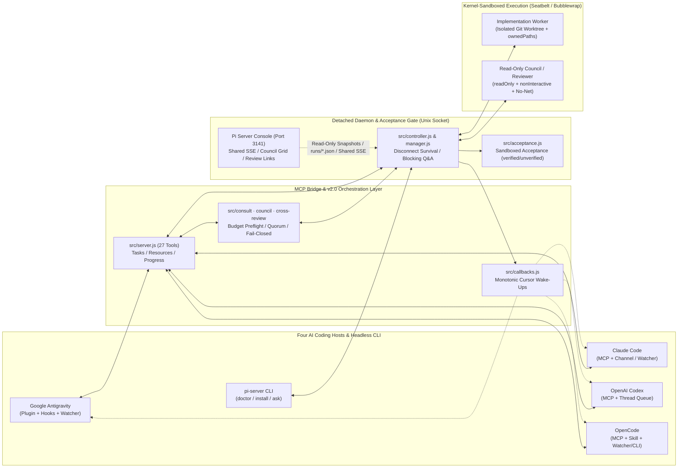

<div align="center">
  
  <h1>Pi Server</h1>
  <p><strong>Orchestrate Multi-Model Councils, Fail-Closed Cross-Reviews, and Sandboxed Mechanical Acceptance Across Four AI Coding Hosts</strong></p>

  <p>
    <a href="https://github.com/paintstar/PI-Server/actions/workflows/ci.yml"></a>
    <a href="LICENSE"></a>
    
    = 22.19" />
    
    
  </p>

  <p>
    <a href="README.md">简体中文</a> · <strong>English</strong> · <a href="#60-second-quick-start">Quick Start</a> · <a href="#why-pi-server-v20">Why v2.0</a> · <a href="#engineering-highlights--source-map">Engineering Depth</a> · <a href="#console-walkthrough">Screenshots</a> · <a href="docs/communication.md">Protocol Spec</a>
  </p>
</div>

<p align="center">
  
</p>

---

**Pi Server v2.0** wraps your local [Pi Coding Agent](https://pi.dev) runtime into a host-agnostic Model Context Protocol (MCP) orchestration platform for **Google Antigravity, Claude Code, OpenAI Codex, and OpenCode**, paired with a zero-framework real-time console (**Pi Server Console** at `http://127.0.0.1:3141/`) and a unified `pi-server` CLI.

Instead of relying on prompt discipline alone, Pi Server v2.0 gives your primary coding agent **high-level multi-model collaboration primitives (`consult`, `council`, `cross_review`)** and **sandboxed mechanical acceptance gates (`acceptanceChecks`)**. Workers execute in isolated Git worktrees under OS-level sandboxing (macOS Seatbelt / Linux & WSL2 `bubblewrap`), backed by a detached Unix-socket controller, blocking parent Q&A, and cross-host monotonic wake-up cursors.

## Why Pi Server v2.0?

| Capability | Typical Multi-Agent Scripts / v1.x Primitives | **Pi Server v2.0** |
| --- | --- | --- |
| **Multi-Model Primitives** | 4–6 manual `spawn/wait/read/close` calls per opinion; no pre-flight budget check | Built-in **`consult`** (one-shot second opinion), **`council`** (2–4 parallel models + deterministic consensus/disagreement/confidence synthesis + `minQuorum` partial fallback), and **`cross_review`** (untracked-aware diff audit with fail-closed verdicts), all supporting **`dryRun`** and **`budgetCapUsd`** |
| **Mechanical Verification** | Turn stop = `completed`; correctness relies on prose claims | **5-tier status semantics + `acceptanceChecks`**: commands run automatically inside the worker's OS sandbox & worktree after settle, separating `completed-verified` vs `completed-unverified`, auto-revalidating after fixes, and mapping failures to MCP Task `failed` |
| **Dual-Platform Kernel Sandbox** | Prompt-only guardrails or macOS-only isolation | **macOS Seatbelt + Linux/WSL2 `bubblewrap` (`bwrap`)**: `strict`/`dev`/`bypass` tiers + `readOnly`/`nonInteractive` network-disabled policies; masks `~/.pi`, `~/.codex`, `~/.claude(.json)`, `~/.gemini`, `~/.config/opencode`, `~/.ssh`, `~/.aws`, `~/.kube`, `~/.gnupg` |
| **Four-Host Native Wake-Ups** | Locked to one IDE; background workers finish silently after parent turn ends | **Install once across 4 hosts**: Antigravity plugin/hooks, Claude Code channel, Codex thread queue, OpenCode JSONC+Skill+CLI wake — deduplicated via shared monotonic cursors |
| **Console & Productized CLI** | Heavy SPA builds or ad-hoc npm scripts; `fnm` ephemeral paths break MCP configs | **Zero-framework ES module console** (shared single-watcher SSE + council grid + review-to-diff links + acceptance trace) and unified **`pi-server` CLI** (`doctor` 8-point probe, `install --dry-run`, `fnm_multishells` symlink stabilization, headless `ask`) |

## 60-Second Quick Start

### Prerequisites

- **OS**: macOS (built-in `/usr/bin/sandbox-exec`) or Linux / Windows WSL2 (`sudo apt-get install -y bubblewrap`)
- **Node.js**: `>= 22.19.0` · **Pi CLI**: `>= 1.0.2` · **Git**
- **Host Client**: Antigravity, Claude Code, Codex, or OpenCode (or headless terminal usage via `pi-server ask`)

### Install, Diagnose, and Launch

```bash
git clone https://github.com/paintstar/PI-Server.git
cd PI-Server

# 1. Install locked dependencies, link CLI, and run offline verification suite (zero model cost)
npm ci --ignore-scripts && npm link
npm run check && npm test

# 2. Run 8-point runtime, sandbox probe, and host config diagnostics
pi-server doctor

# 3. Preview and register installed hosts, then open the local console
pi-server install --dry-run
pi-server install
pi-server dashboard --open
```

> Legacy `npm run install:*` / `uninstall:*` scripts remain supported. Use `pi-server ask <provider/model> "<question>" --dry-run` for headless terminal or CI consultations over the detached controller.

## Architecture



## Engineering Highlights & Source Map

- **Detached Unix-Socket Daemon & Safe Hot-Upgrade** ([src/controller.js](src/controller.js) · [src/controller-client.js](src/controller-client.js)): Survives MCP disconnects without dropping active workers or blocking questions; preserves bound `parentInfo` across reconnects and hot-replaces stale daemons only when `liveProcesses === 0 && activeParents === 0 && inflightOps === 0`.
- **Deadlock-Free Mechanical Acceptance Loop** ([src/acceptance.js](src/acceptance.js) · [src/manager.js](src/manager.js) · [src/task-store.js](src/task-store.js)): Executes `acceptanceChecks` inside the worker's exact `toolPolicy` sandbox with bounded 8KB sliding output capture and a 300s batch cap; aborts acceptance process trees synchronously *before* entering `serial()` on `interrupt`/`closeAgent`; maps `completed-unverified` to MCP Task `failed` (`isError: true`).
- **Dual-Platform Kernel Sandboxing & Concurrent Read-Only Workers** ([src/tool-sandbox.js](src/tool-sandbox.js) · [src/linux-sandbox.js](src/linux-sandbox.js) · [extensions/policy.ts](extensions/policy.ts)): Enforces Seatbelt and `bubblewrap` isolation across `strict`/`dev`/`bypass` plus `readOnly`/`nonInteractive` modes (binding regular credential files like `~/.claude.json` to `/dev/null` under `bwrap` to avoid `ENOTDIR`), allowing parallel multi-model councils on dirty repositories with zero path overlap conflicts.
- **Zero-Framework Console with Shared SSE Broadcaster** ([src/dashboard.js](src/dashboard.js) · [src/dashboard-sse.js](src/dashboard-sse.js) · [dashboard/collab-views.js](dashboard/collab-views.js)): Strict CSP (`default-src 'self'`), custom DOM morphing, `mtimeMs` snapshot caching, and automated test guardrails enforcing `<500`/`<450` line limits and zero leading comments on modular files.
- **Ephemeral `fnm` Path Stabilization & 8-Point Diagnostics** ([src/bin-resolve.js](src/bin-resolve.js) · [bin/pi-server.js](bin/pi-server.js)): Stabilizes `fnm_multishells` symlink prefixes without dereferencing `bin/pi` into `cli.js`, filters login-shell MOTD noise, and probes real OS sandbox execution in `pi-server doctor`.

## Console Walkthrough

### 1. Context Window Telemetry & Growth Curve
<p align="center">
  
</p>

### 2. Read-Only Inline Git Worktree Diffs & Cross-Review Findings
<p align="center">
  
</p>

### 3. Model Profiles, Four-Host Matrix & Masked Credentials
<p align="center">
  
</p>

## MCP Tool Reference (27 Tools)

- **High-Level Collaboration (v2.0, 3)**: `consult`, `council`, `cross_review`
- **Lifecycle & Workspace (10)**: `spawn_agent` (with `acceptanceChecks`), `wait_agent`, `read_agent`, `send_message`, `set_agent_model`, `interrupt_agent`, `close_agent`, `resume_agent`, `list_agents`, `organize_agents`
- **Model Profiles, Health & Quota (4)**: `get_model_profiles`, `list_models`, `get_quota`, `get_subagent_health`
- **Durable Q&A, Callbacks & Diff Review (6)**: `reply_question`, `read_messages`, `ack_messages`, `bind_session`, `set_agent_callback`, `get_agent_changes` (untracked-aware)
- **Policy Governance & Standard MCP Tasks (4)**: `update_agent_policy`, `get_client_capabilities`, `run_agent_task`, `resume_task`

## Documentation & License

- [Protocol, Sandbox & Reliability Spec (中文)](docs/communication.md) · [Verification Matrix (中文)](docs/verification.md) · [Contributing Guide](CONTRIBUTING.md) · [Security Policy](SECURITY.md) · [Changelog](CHANGELOG.md)
- Released under the [MIT License](LICENSE) (Copyright © 2026 mumuxsy & shin).
