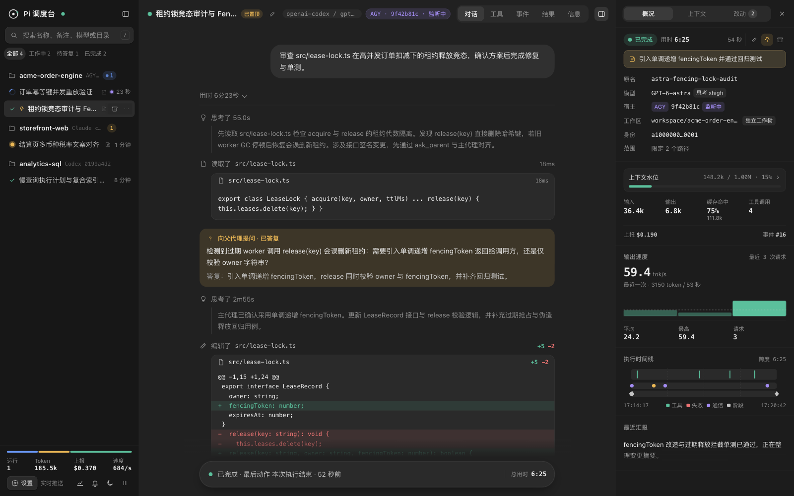
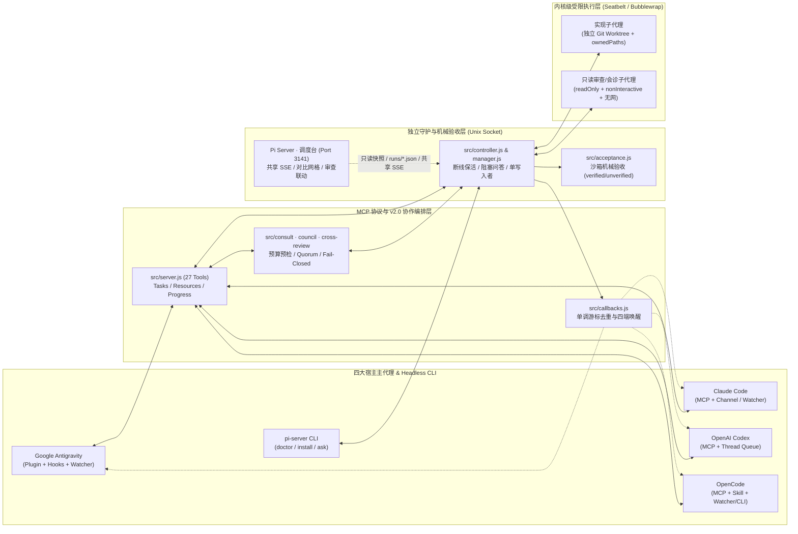
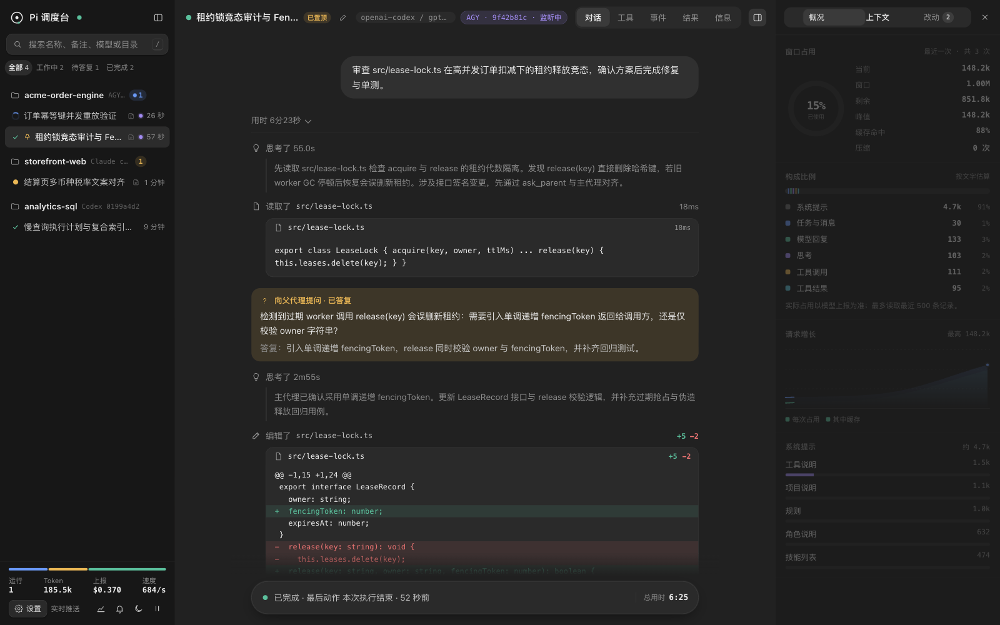
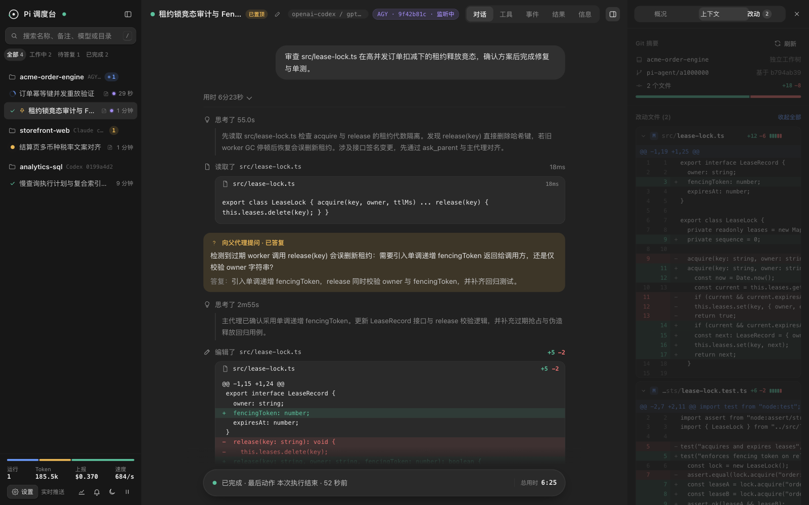

<div align="center">
  
  <h1>Pi Server · Pi 调度台</h1>
  <p><strong>让主 AI 编程助手在 OS 级沙箱中编排多模型委员会、交叉审查与机械化验收——四端原生协同，断线不丢现场</strong></p>

  <p>
    <a href="https://github.com/paintstar/PI-Server/actions/workflows/ci.yml"></a>
    <a href="LICENSE"></a>
    
    = 22.19" />
    
    
  </p>

  <p>
    <strong>简体中文</strong> · <a href="README.en.md">English</a> · <a href="#60-秒极速上手">快速开始</a> · <a href="#为什么是-pi-server-v20">核心差异</a> · <a href="#工程亮点与源码地图">工程深度</a> · <a href="#界面与功能导览">控制台预览</a> · <a href="docs/communication.md">协议与沙箱规范</a>
  </p>
</div>

<p align="center">
  
</p>

---

**Pi Server v2.0** 将本机 [Pi Coding Agent](https://pi.dev) 运行时封装为面向四大主流 AI 宿主（**Google Antigravity、Claude Code、OpenAI Codex、OpenCode**）的多模型编排 MCP 平台，并配套零外部前端框架依赖的实时控制台 **Pi Server · 调度台**（`http://127.0.0.1:3141/`）与统一命令行工具 `pi-server`。

主代理不再只靠 prompt 自律，而是拥有**高层多模型协作原语（`consult` / `council` / `cross_review`）**与**机械化沙箱验收门禁（`acceptanceChecks`）**：所有子代理都在独立 Git 工作树与操作系统内核沙箱（macOS Seatbelt / Linux & WSL2 `bubblewrap`）中受控执行，具备独立守护进程断线保活、阻塞式 `ask_parent` 问答与跨宿主单调游标唤醒。

## 为什么是 Pi Server v2.0？

| 维度 | 传统多 Agent 脚本 / v1.x 基础原语 | **Pi Server v2.0** |
| --- | --- | --- |
| **多模型协作语义** | 需 4–6 次手工调用 `spawn/wait/read/close`，无并行对比与成本预检 | 内置 **`consult`**（一次性第二意见）、**`council`**（2–4 模型并行会诊 + 确定性共识/分歧/置信度合成 + `minQuorum` 降级）、**`cross_review`**（含未跟踪新建文件 diff 的 Fail-Closed 交叉审查），全系支持 **`dryRun`** 与 **`budgetCapUsd`** 预检 |
| **验收与完成语义** | 模型输出停止即标 `completed`，全靠主代理肉眼核对 | **五级状态隔离 + 机械化 `acceptanceChecks`**：子代理结算后在原 OS 沙箱与工作树内自动跑命令，严格区分 `completed-verified` 与 `completed-unverified`，修完自动重验，MCP Task 同步映射失败态 |
| **跨平台内核沙箱** | 仅提示词约束或单一平台沙箱，易泄露本机凭据 | **macOS Seatbelt + Linux / WSL2 `bubblewrap`（`bwrap`）双引擎**：`strict`/`dev`/`bypass` 三档 + `readOnly`/`nonInteractive` 只读禁网策略，屏蔽 `~/.pi`、`~/.codex`、`~/.claude(.json)`、`~/.gemini`、`~/.config/opencode`、`~/.ssh`、`~/.aws` 等凭据 |
| **四端协同与唤醒** | 绑定单一 IDE，主回合结束后无法自动感知后台子代理完成 | **一处安装，四端原生协同**：Antigravity 插件+Hooks、Claude Code Channel、Codex Thread Queue、OpenCode JSONC+Skill+CLI Wake，全通道共享单调游标防重放 |
| **控制台与产品化 CLI** | 依赖重型前端构建或零散 npm 脚本，`fnm` 临时路径常致配置失效 | **零框架 ES 模块实时控制台**（共享单实例 SSE + 会诊对比网格 + 审查结论联动 Diff + 验收明细）与统一 **`pi-server` CLI**（`doctor` 八维体检、`install --dry-run`、`fnm_multishells` 软链稳定化、`ask` Headless 咨询） |

## 60 秒极速上手

### 环境要求

- **操作系统**：macOS（内置 `/usr/bin/sandbox-exec`）或 Linux / Windows WSL2（`sudo apt-get install -y bubblewrap`）
- **Node.js**：`>= 22.19.0` · **Pi CLI**：`>= 1.0.2` · **Git**
- **宿主客户端**：Google Antigravity、Claude Code、OpenAI Codex、OpenCode 任一（或直接用 `pi-server ask` 无宿主终端调用）

### 三步安装、体检与启动

```bash
git clone https://github.com/paintstar/PI-Server.git
cd PI-Server

# 1. 安装固定依赖、链接统一 CLI 并运行离线全量验证（零模型费用）
npm ci --ignore-scripts && npm link
npm run check && npm test

# 2. 运行八维环境体检（自动检测 Node/Pi 稳定路径、双平台沙箱探针与四端配置）
pi-server doctor

# 3. 预览并一键接入本机已安装的四大宿主，打开实时调度台
pi-server install --dry-run
pi-server install
pi-server dashboard --open
```

> 也可直接使用 `npm run install:all` / `install:antigravity` / `install:claude` / `install:codex` / `install:opencode`；支持 `pi-server uninstall <target>` 带 `0600` 自动备份安全卸载，以及 `pi-server ask <provider/model> "<question>" --dry-run` 在终端或 CI 中直连后台控制器发起一次性沙箱咨询。

### 一句话实战调度示例

在任意已接入的宿主聊天中输入：

> 先用 `council`（开 `dryRun: true` 看预估后再实跑）并行请 3 个不同模型评审 `src/payment/` 的并发锁方案，输出共识与分歧；确定方案后用 `spawn_agent` 派发实现并挂上 `acceptanceChecks: [{ command: "npm test", expectExit: 0 }]`；验收转 `completed-verified` 后再用另一个模型运行 `cross_review` 审查全部改动（含新建文件）。

## 系统架构



## 工程亮点与源码地图

- **独立 Unix Socket 守护与热升级护栏**（[src/controller.js](src/controller.js) · [src/controller-client.js](src/controller-client.js)）：MCP 断开不杀死后台子代理与阻塞中的 `ask_parent`；重连自动透传父会话身份，且仅在 `liveProcesses === 0 && activeParents === 0 && inflightOps === 0` 三零条件下执行控制器平滑热替换。
- **机械化验收闭环与零死锁中断**（[src/acceptance.js](src/acceptance.js) · [src/manager.js](src/manager.js) · [src/task-store.js](src/task-store.js)）：子代理结算后在原 `toolPolicy` 沙箱内跑 `acceptanceChecks`（8KB 滑动缓冲、整批 ≤300s 总超时），`interrupt`/`closeAgent` 在进入 `serial()` 队列前同步触发 `AbortSignal` 立即清理整棵进程树；`completed-unverified` 同步映射为 MCP Task `failed` + `isError: true`。
- **双平台内核沙箱与只读并行隔离**（[src/tool-sandbox.js](src/tool-sandbox.js) · [src/linux-sandbox.js](src/linux-sandbox.js) · [extensions/policy.ts](extensions/policy.ts)）：macOS Seatbelt 与 Linux/WSL2 `bwrap` 同步实现 `strict`/`dev`/`bypass` 与 `readOnly`/`nonInteractive` 策略（普通凭据文件如 `~/.claude.json` 在 `bwrap` 下绑定 `/dev/null` 防 `ENOTDIR`），支持多模型在脏工作区零冲突并发只读会诊。
- **零外部框架实时控制台与单实例 SSE 广播**（[src/dashboard.js](src/dashboard.js) · [src/dashboard-sse.js](src/dashboard-sse.js) · [dashboard/collab-views.js](dashboard/collab-views.js)）：严守严格 CSP（`default-src 'self'`）、自研 DOM morph 与 `mtimeMs` 缓存，单文件模块严格受测试守护（`src/*.js < 500` 行、`dashboard/*.js < 450` 行、新模块零行首注释）。
- **`fnm_multishells` 软链稳定化与八维环境体检**（[src/bin-resolve.js](src/bin-resolve.js) · [bin/pi-server.js](bin/pi-server.js)）：精准解引用临时 `fnm` 会话目录而不穿透 `bin/pi` 自身软链，结合 MOTD 抗噪与实时沙箱探针，根治多宿主安装配置漂移。

## 界面与功能导览

### 1. 上下文窗口构成与增长曲线
实时追踪每次请求的窗口占用（支持 1M 上下文配置）、系统提示词各分区占比与多轮增长趋势。

<p align="center">
  
</p>

### 2. 只读 Git 工作树内联差异与交叉审查联动
自动对比基准提交并纳入未跟踪新建文件；在「结果」Tab 查看 `council` 多模型对比与 `cross_review` 分级 findings，点击文件路径直达右侧「改动」内联 Diff。

<p align="center">
  
</p>

### 3. 模型画像、四端宿主矩阵与脱敏凭据设置中心
零手改 JSON：在左下角设置弹窗管理服务商开关、脱敏 Key、Codex OAuth 同步与 1M 上下文覆盖（写前自动 `0600` 备份），并在系统弹窗一屏查看双平台沙箱与四端接入状态。

<p align="center">
  
</p>

## 四大宿主接入与回调唤醒

| 宿主客户端 | 会话绑定方式 | 自动唤醒与防漏等机制 |
| --- | --- | --- |
| **Google Antigravity** | `antigravitySessionId` 或 `bind_session` | 插件内置 `PreInvocation` / `Stop` 钩子自动注入未读事件并拦截至早收尾，配合 `wait-events --session` 共享单调游标去重 |
| **Claude Code** | 自动识别 `CLAUDE_CODE_SESSION_ID` | 开发通道模式推送 `notifications/claude/channel`，通用模式运行后台 `npm run wait-events -- --agent <id>` |
| **OpenAI Codex** | 传入 `callback.codexThreadId` | 通过 `codex queue --thread <id>` 将完成、提问、异常与预算事件排入父会话队列 |
| **OpenCode** | `opencodeSessionId` / `parentSession` / `bind_session` | 保留注释写入 `opencode.jsonc` 并安装 `SKILL.md`，支持 `wait-events --session` 与可选 `opencodeCliWake` |

## 27 个 MCP 工具全览

<details>
<summary>点击展开全部 27 个 MCP 工具分类索引（含 v2.0 新增 3 个高层协作原语）</summary>

### 高层多模型协作原语（v2.0 新增，3 个）
| 工具名 | 只读 | 说明 |
| --- | :---: | --- |
| `consult` | 否 | 一次性只读第二意见（自动 spawn → wait → read → close → archive），支持 `style`、`contextFiles`、`dryRun` 与 `budgetCapUsd` |
| `council` | 否 | 2–4 模型并行只读会诊，输出确定性共识/分歧/立场分布/置信度，支持脏工作区并发、`cleanProfile`、`minQuorum` 降级与 `dryRun` |
| `cross_review` | 否 | 跨模型审查已结算子代理的完整 Git Diff（含未跟踪新文件）与机械验收结果，Fail-Closed 输出 `approve` / `concerns` / `blockers` 与分级 findings |

### 会话创建与生命周期（10 个）
`spawn_agent`（支持 `acceptanceChecks` 机械验收检查）、`wait_agent`、`read_agent`、`send_message`、`set_agent_model`、`interrupt_agent`、`close_agent`、`resume_agent`、`list_agents`、`organize_agents`

### 模型画像、健康与额度（4 个）
`get_model_profiles`、`list_models`、`get_quota`、`get_subagent_health`

### 可靠通信、回调与审查（6 个）
`reply_question`、`read_messages`、`ack_messages`、`bind_session`、`set_agent_callback`、`get_agent_changes`（支持 `includeUntracked`）

### 策略治理与标准 MCP Tasks（4 个）
`update_agent_policy`、`get_client_capabilities`、`run_agent_task`、`resume_task`

</details>

## 环境变量参考

| 环境变量 | 默认值 | 作用 |
| --- | --- | --- |
| `PI_SERVER_STATE_DIR` | `<仓库根目录>/.agents/runtime` | 会话、控制器 Socket、工作树与 `runs/*.json` 的存储目录（`0700`） |
| `PI_DASHBOARD_PORT` / `PI_DASHBOARD_AUTO` | `3141` / `1` | 调度台本地端口（仅 `127.0.0.1`）及是否在 MCP 启动时自动拉起 |
| `PI_SERVER_MAX_AGENTS` | `50` | 单控制器最大并发子代理上限（`1`–`50`） |
| `PI_EXECUTABLE` / `PI_NODE_EXECUTABLE` | 自动稳定解析 | 显式覆盖 Pi CLI / Node.js 绝对路径 |
| `PI_CODING_AGENT_DIR` | `~/.pi/agent` | 指定读取 Pi `auth.json` 与 `models.json` 的配置目录 |
| `PI_BWRAP_EXECUTABLE` | 自动探测 `bwrap` | 在 Linux / WSL2 上显式指定 `bubblewrap` 路径 |
| `PI_SERVER_CONFIRM_POLICY` | `0` | 设为 `1` 时对 `update_agent_policy` 启用 MCP Elicitation 确认表单 |

## 深入文档与开源协议

- [可靠通信、权限沙箱与协议规范](docs/communication.md) · [验证矩阵与离线回归记录](docs/verification.md) · [代码结构与维护约定](AGENTS.md)
- [参与贡献指南](CONTRIBUTING.md) · [安全漏洞私密上报](SECURITY.md) · [版本更新记录](CHANGELOG.md)
- 基于 [MIT License](LICENSE) 开源发布（Copyright © 2026 mumuxsy & shin）。
