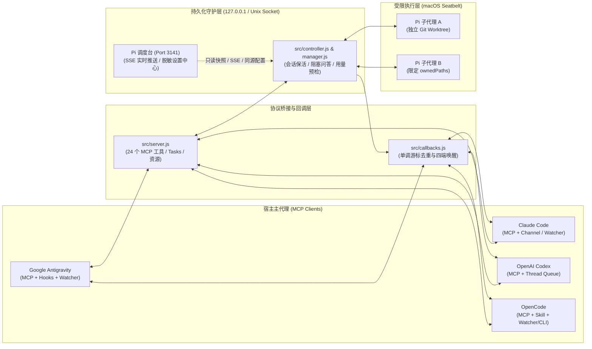
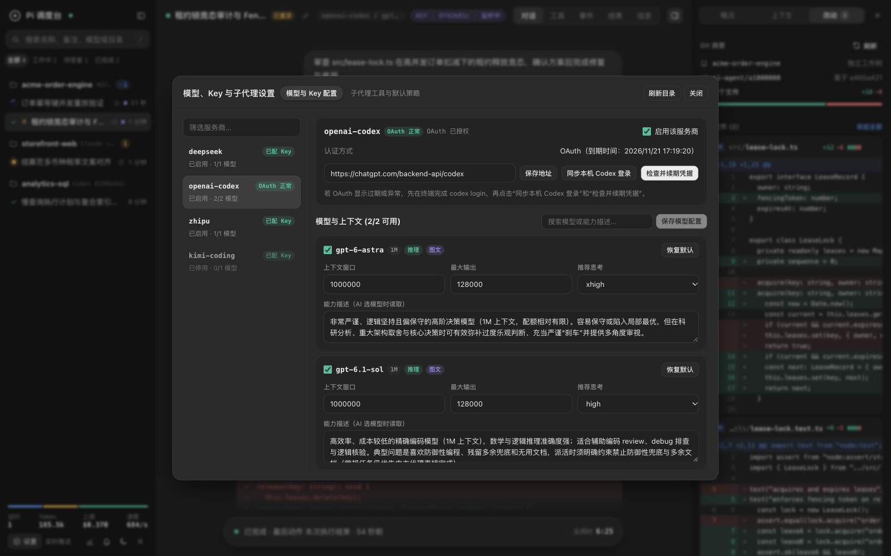

<div align="center">
  
  <h1>Pi Subagents · Pi 调度台</h1>
  <p><strong>面向 Google Antigravity、Claude Code、OpenAI Codex 与 OpenCode 的多模型子代理 MCP 调度平台与实时控制台</strong></p>

  <p>
    <a href="https://github.com/mumuxsy/pi-subagents/actions/workflows/ci.yml"></a>
    <a href="LICENSE"></a>
    = 22.19" />
    
    
  </p>

  <p>
    <strong>简体中文</strong> · <a href="README.en.md">English</a> · <a href="#快速开始">快速开始</a> · <a href="#界面与功能导览">界面预览</a> · <a href="#24-个-mcp-工具全览">工具参考</a> · <a href="docs/communication.md">通信与沙箱协议</a>
  </p>
</div>

<p align="center">
  
</p>

---

**Pi Subagents** 将本机 [Pi Coding Agent](https://pi.dev) 封装为通用的模型上下文协议（MCP）子代理调度中心，并内置零外部前端框架依赖的本机实时控制台 **Pi 调度台**（`http://127.0.0.1:3141/`）。主代理负责拆解任务、按模型画像选型与验收代码；各个子代理在独立的 Git 工作树与操作系统级沙箱中并行执行开发、审查或排错任务，支持断线保活、阻塞提问与跨宿主自动唤醒。

## 核心特性

- **一处安装，四端原生协同**：解除了与单一客户端的绑定，同时适配 **Google Antigravity**（自动打包安装插件、规则、技能与 `PreInvocation` / `Stop` 生命周期钩子）、**Claude Code**（支持 `claude/channel` 通知与后台事件监听）、**OpenAI Codex**（支持 `codex queue` 会话队列唤醒）以及 **OpenCode**（写入 `opencode.jsonc` `mcp.servers`、自动安装 `SKILL.md` 并支持会话绑定、`wait-events` 监听与可选 CLI 会话唤醒）。
- **独立控制进程，断线不丢现场**：MCP 桥接进程通过私密 Unix Socket 连接后台独立控制器（`src/controller.js`）。主聊天窗口关闭或重连不会终止运行中的 Pi 子进程与待答复问题，新会话可随时调用 `resume_agent` 无损接手。
- **可靠双向通信与阻塞式提问**：子代理可通过 `agent_message` 汇报阶段进展或与同组兄弟代理协作，遇到需求歧义时调用 `ask_parent` 原地暂停等待；主会话调用 `reply_question` 明确答复后子代理立即继续执行，支持幂等 `requestId` / `messageId` 防重放。
- **实时三栏控制台“Pi 调度台”**：按宿主父会话自动分组，中间区域支持逐字流式推理与折叠式工具执行回放，右侧检查器提供会话概况、输出速度（`tok/s`）、上下文窗口水位与只读 Git 工作树内联差异（Diff），并与 `organize_agents` 工具实时同步自定义标题、备注、置顶与归档状态。
- **模型能力画像与脱敏设置中心**：提供 `get_model_profiles` 工具与面板左下角设置中心，集中维护各服务商启停、脱敏 API Key、本机 Codex OAuth 一键导入、自定义上下文窗口（支持设为 1M 上下文并同步写回 `models.json`）、推荐思考强度与中文能力描述，让主代理在派活前有据可依。
- **macOS Seatbelt 内核级三档沙箱**：通过 `/usr/bin/sandbox-exec` 约束工具与后代 shell 进程，默认在 Git 仓库分配独立 `worktree` 分支并在共享目录下强制校验不重叠的 `ownedPaths`；默认屏蔽 `~/.pi`、`~/.codex`、`~/.ssh`、`~/.config/opencode` 与 `~/.local/share/opencode` 等凭据目录，防止密钥外泄。
- **多渠道套餐额度只读查询**：内置 `get_quota` 工具，在内存中只读使用本机 Pi 凭据查询 Codex、智谱 GLM / Z.ai、MiniMax Token Plan、DeepSeek 与 OpenCode Go 的周期剩余比例或账户余额，不改写凭据文件，也不暴露账号身份。

## 系统架构



## 界面与功能导览

### 1. 上下文窗口构成与增长曲线
实时追踪每次模型请求的实际窗口占用（输入 + 缓存读写）、系统提示词各分区占比以及多轮请求增长趋势，直观判断何时需要拆分任务或压缩历史。

<p align="center">
  
</p>

### 2. 只读 Git 工作树内联差异审查
在独立 `worktree` 或受限 `ownedPaths` 内自动对比基准提交，在面板右侧或通过 `get_agent_changes` 工具直接审阅子代理修改的每一行代码，确认无误后再由主代理合并。

<p align="center">
  
</p>

### 3. 模型画像、1M 上下文配置与脱敏凭据设置中心
无需手动编辑底层 JSON：在左下角设置弹窗即可切换服务商与模型开关、更新脱敏展示的 API Key 或 Base URL、同步本机 Codex OAuth 登录，并为每款模型编写适用场景与短板提示（修改前自动以 `0600` 权限备份原文件）。

<p align="center">
  
</p>

## 快速开始

### 环境要求

- **操作系统**：macOS（沙箱执行依赖系统内置的 `/usr/bin/sandbox-exec`）
- **Node.js**：`>= 22.19.0`
- **Pi CLI**：`>= 1.0.2`（需提前在终端完成 `pi` 安装及至少一个模型渠道登录）
- **宿主工具**：Google Antigravity、Claude Code、OpenAI Codex 或 OpenCode 任一即可

### 安装与接入

```bash
git clone https://github.com/mumuxsy/pi-subagents.git
cd pi-subagents

# 1. 安装固定依赖并运行语法与全量沙箱测试（离线执行，不消耗模型额度）
npm ci --ignore-scripts
npm run check
npm test

# 2. 一键接入本机已安装的 Antigravity、Claude Code、Codex 与 OpenCode
npm run install:all
```

也可以按需单独安装或卸载某一端（安装前会自动把原客户端配置以 `0600` 权限备份至 `.agents/records/config-backups/`，卸载不会删除源码、Pi 凭据或历史会话）：

```bash
npm run install:antigravity   # 生成并严格校验 ~/.gemini/config/plugins/pi-subagents 插件包
npm run install:claude        # 写入 ~/.claude.json 用户级 MCP 配置
npm run install:codex         # 写入 ~/.codex/config.toml 全局 MCP 配置
npm run install:opencode      # 写入 ~/.config/opencode/opencode.jsonc 的 mcp.servers 并安装 Skill

npm run uninstall:antigravity # 移除 Antigravity 插件接入
npm run uninstall:claude      # 移除 Claude Code 接入
npm run uninstall:codex       # 移除 Codex 接入
npm run uninstall:opencode    # 保留注释安全移除 OpenCode MCP 配置与 Skill
```

> **提示**：安装器在客户端配置中写入了当前仓库的绝对路径，移动仓库目录或升级 Node 版本后请重新运行一次安装命令。已打开的宿主聊天窗口重开新会话即可加载新版工具。

### 打开 Pi 调度台

MCP 服务首次启动时会自动在后台拉起或复用面板；你也可以随时手动启动：

```bash
npm run dashboard
# 浏览器打开 http://127.0.0.1:3141/
```

## 四大宿主接入与回调唤醒

MCP 协议本身不保证在主代理结束一轮回复后重新唤醒模型，因此 Pi Subagents 针对四大宿主分别提供了防漏等提醒（`mustWait`）与原生唤醒通道：

| 宿主客户端 | 会话绑定方式 | 自动唤醒与防漏等机制 |
| --- | --- | --- |
| **Google Antigravity** | `spawn_agent` 传入 `antigravitySessionId`（当前会话 ID），或调用 `bind_session` | 插件内置 `PreInvocation` 与 `Stop` 钩子自动注入未读事件并拦截未挂监听器的过早收尾；同时可运行返回结果中的 `mustWait.antigravityBackgroundCommand`（`node scripts/wait-events.js --session <id>`）后台监听即时唤醒，全部通道共用单调游标去重。 |
| **Claude Code** | 自动识别 `CLAUDE_CODE_SESSION_ID` 并在面板分组 | 以开发通道启动（`claude --dangerously-load-development-channels server:pi-subagents`）时直接推送 `notifications/claude/channel`；普通模式下将 `npm run wait-events -- --agent <id>` 放到后台运行即可在事件到达时唤醒主会话。 |
| **OpenAI Codex** | 在 shell 读取 `echo $CODEX_THREAD_ID`，传入 `callback.codexThreadId` | 子代理完成、提问、失败或触及策略上限时，桥接进程自动执行 `codex queue --thread <id> --message ...` 将通知排入对应会话队列。 |
| **OpenCode** | `spawn_agent` 传入 `opencodeSessionId`（或 `parentSession: { kind: "opencode", sessionId }`），或调用 `bind_session(kind="opencode")` | 自动识别 `opencode` MCP 客户端并安装 `~/.config/opencode/skills/pi-subagents/SKILL.md`；支持 `wait_agent`、后台 `mustWait.opencodeBackgroundCommand`（`scripts/wait-events.js --session <id>`）以及可选 `callback.opencodeCliWake=true` 通过 `opencode run --session <id>` 唤醒会话，全通道共用单调游标去重。 |

### 对话调度示例

在任意已接入的宿主聊天中输入：

> 请先调用 `get_model_profiles` 查看当前启用的模型画像，再用 `pi-subagents` 启动两个独立子代理：一个用高推理模型审查 `src/order/` 的并发锁边界，另一个为 `src/payment/` 补充幂等回归测试。给两边声明不冲突的 `ownedPaths`，遇到子代理提问及时答复，等两边全部结束后用 `get_agent_changes` 检查实际改动并跑通测试。

## 24 个 MCP 工具全览

### 会话创建与生命周期（10 个）

| 工具名 | 只读 | 说明 |
| --- | :---: | --- |
| `spawn_agent` | 否 | 创建独立 Pi 子代理，指定服务商/模型、思考强度、工作区模式（`auto` / `worktree` / `shared`）、`ownedPaths`、宿主会话编号与初始任务 |
| `wait_agent` | 是 | 阻塞等待一个或多个子代理产生新事件、提问或结束（单次最长 45 秒），返回递增 `nextSequence` 与仍在运行的 `pending` 列表 |
| `read_agent` | 是 | 按事件序号分页读取子代理状态、实际 Token 用量、最近回复及有限长度的对话记录 |
| `send_message` | 否 | 向子代理追加指令：`steer` 在当前工具结束后立即插入，`follow_up` 等当前回合整体完成后执行 |
| `set_agent_model` | 否 | 为空闲子代理切换模型与思考强度；传入 `scope: "next_run"` 可在下一次运行结束后自动恢复原模型 |
| `interrupt_agent` | 否 | 清空待执行指令队列并中止当前运行（已落盘的文件修改保留，不会自动回滚） |
| `close_agent` | 否 | 停止并关闭指定 Pi 子进程，保留会话记录与 Git 工作树供后续审查或恢复 |
| `resume_agent` | 否 | 显式接手已保存的历史会话或桥接断开后仍在后台运行的会话，不会重复发送旧任务 |
| `list_agents` | 是 | 列出当前活跃或历史保存的子代理，支持按宿主 `sessionId` 和 `archiveFilter`（活跃/已归档）过滤，并返回面板地址 |
| `organize_agents` | 否 | 修改会话显示标题、摘要备注、置顶、分组、手动状态标记或归档已完成会话，与 3141 面板实时共享 |

### 模型画像、健康与额度（4 个）

| 工具名 | 只读 | 说明 |
| --- | :---: | --- |
| `get_model_profiles` | 是 | 一次获取已启用模型的上下文窗口、推荐思考强度、中文能力与差异描述、脱敏服务商就绪状态、6 个内置子代理工具清单与默认沙箱策略 |
| `list_models` | 是 | 列出本机 Pi 可用模型目录（默认过滤已在设置中心停用的模型，传 `includeDisabled: true` 可查看全部） |
| `get_quota` | 是 | 使用本机 Pi 凭据只读查询 Codex、智谱 GLM / Z.ai、MiniMax Token Plan、DeepSeek 与 OpenCode Go 套餐窗口或余额 |
| `get_subagent_health` | 是 | 检查 Pi 可执行文件、后台控制进程、macOS `sandbox-exec`、可用模型数、面板地址及插件钩子健康状态 |

### 可靠通信、回调与审查（6 个）

| 工具名 | 只读 | 说明 |
| --- | :---: | --- |
| `reply_question` | 否 | 明确回答子代理通过 `ask_parent` 提出的阻塞问题并放行等待中的工具 |
| `read_messages` | 是 | 按游标分页读取持久化消息回执（区分 `accepted`、`consumed` 与 `acknowledged` 状态） |
| `ack_messages` | 否 | 显式确认主会话已读取指定消息列表 |
| `bind_session` | 否 | 将当前连接及指定子代理绑定到 Antigravity 或其他宿主会话编号，统一面板分组与回调追踪 |
| `set_agent_callback` | 否 | 动态开启、关闭或调整子代理唤醒回调的目标会话与事件类型（默认监听 `settled`、`question`、`process_failed`、`budget_limit`、`control_failed`） |
| `get_agent_changes` | 是 | 只读检查子代理在工作树或 `ownedPaths` 内的真实 Git 状态、提交记录与有限长度的 Diff |

### 策略治理与标准 MCP Tasks（4 个）

| 工具名 | 只读 | 说明 |
| --- | :---: | --- |
| `update_agent_policy` | 否 | 在获得用户明确授权后，更新空闲子代理的允许模型、联网开关、沙箱档位或用量上限 |
| `get_client_capabilities` | 是 | 查看当前宿主客户端协商的 MCP 协议能力与回调支持情况 |
| `run_agent_task` | 否 | 供支持 MCP 2025-11-25 Tasks 协议的客户端以标准异步任务方式启动子代理 |
| `resume_task` | 否 | 在前一个主会话断开后显式接手持久化的标准 MCP 任务 |

## 安全沙箱、用量统计与评测模式

### 三档沙箱模式对比

可通过面板左下角“设置 → 子代理工具与默认策略”、单代理 `policy.sandboxMode` 参数，或项目内 `.agents/sandbox.json`（写入 `{"mode":"dev"}`）切换（单代理 `policy.sandboxMode` 优先级最高）：

| 沙箱档位 | 允许读取范围 | 允许写入范围 | 凭据与控制状态保护 | 典型适用场景 |
| --- | --- | --- | --- | --- |
| **`strict`**（默认） | 工作目录与系统运行目录 | 仅声明的 `ownedPaths` 与私有临时目录 | 禁止读写 `~/.pi`、`~/.codex`、`~/.ssh` 与控制进程目录 | 只读代码审查、限定单模块的局部修改 |
| **`dev`** | 除敏感凭据与控制目录外的本机开发工具链 | 整个子代理工作树、Git 目录、`~/.cache`、`~/.local/share/uv`、`~/Library/Caches` | 禁止读写 `~/.pi`、`~/.codex`、`~/.ssh` 与控制进程目录 | 需要子代理自行运行 `uv` / Python / Node 测试与本地提交 |
| **`bypass`** | 本机全部常规与凭据路径 | 本机任意路径（控制进程目录除外） | **仅保护控制进程目录**（模型可读到 SSH 与 Pi 密钥） | 仅用于你完全信任且确需跨目录读写配置的本机任务 |

### 用量统计与洁净评测模式

- **非缓存 Token 统计**：内置默认上限已放宽为单会话 `100,000` 次请求、`1e12` 非缓存读取 Token、最长运行 `7` 天、单次输出 `128,000` Token。`policy.maxTotalTokens` 只累计实际新增消耗（`input + output + cacheWrite`），不会把多轮工具调用重复命中的缓存前缀（`cacheRead`）反复叠加；当配置了自定义上限并达到 80% 时，系统会自动提醒子代理先通过 `agent_message` 汇报进展。
- **洁净评测模式（Benchmark Clean Profile）**：进行跨模型对比实验时，可在 `spawn_agent.context` 中单独一行传入 `BENCHMARK_PROMPT_PROFILE=clean`。该选项会在子代理启动前清空继承的全局/项目 `AGENTS.md` 与技能列表，同时完整保留基础编码提示词、6 个工具、父会话指令与全部沙箱策略，避免个性化规则干扰基准评测。

## 环境变量参考

| 环境变量 | 默认值 | 作用 |
| --- | --- | --- |
| `PI_SUBAGENTS_STATE_DIR` | `<仓库根目录>/.agents/runtime` | 指定会话、控制进程 Socket、工作树与配置的本机存储目录 |
| `PI_DASHBOARD_PORT` | `3141` | 指定 Pi 调度台监听的本地端口（仅绑定 `127.0.0.1`） |
| `PI_DASHBOARD_AUTO` | `1` | 设为 `0` 时禁止 MCP 服务启动时自动拉起 Web 调度台 |
| `PI_SUBAGENTS_MAX_AGENTS` | `50` | 单个控制进程允许同时打开的最大 Pi 会话数（范围 `1`–`50`） |
| `PI_SUBAGENTS_CONFIRM_POLICY` | `0` | 设为 `1` 时，调用 `update_agent_policy` 会在支持 Elicitation 的客户端弹出确认表单 |
| `PI_EXECUTABLE` | 自动解析 `PATH` 中的 `pi` | 显式指定本机 Pi CLI 的绝对可执行路径 |
| `PI_CODING_AGENT_DIR` | `~/.pi/agent` | 指定读取 Pi `auth.json` 与 `models.json` 的配置目录 |

## 能力边界说明

- **费用与授权边界**：子代理的 `usage.reportedCost` 根据模型目录静态单价估算，自定义渠道可能显示为 `0`，不能替代服务商真实账单；`get_quota` 返回套餐有剩余额度也不等于用户已授权消费，主代理在扩大付费模型调用范围前仍须征得用户同意。
- **平台与验收边界**：进程级工具隔离依赖 macOS Seatbelt，非 macOS 平台运行受限子代理会安全报错退出；子代理状态变为 `completed` 仅代表该回合模型停止输出，代码正确性仍需主代理结合 `get_agent_changes` 与测试命令独立验收。

## 深入文档与治理

- [可靠通信、权限沙箱与协议规范](docs/communication.md)
- [验证矩阵与 89 项回归记录](docs/verification.md)
- [代码结构与维护约定](AGENTS.md)
- [参与贡献指南](CONTRIBUTING.md) · [安全漏洞私密上报](SECURITY.md) · [版本更新记录](CHANGELOG.md)

## 致谢与开源协议

- 套餐额度只读查询接口格式参考了 [CodexBar](https://github.com/steipete/CodexBar) 的公开协议说明与各模型服务商官方文档，由本项目使用 Node.js 独立实现。
- 本项目基于 [MIT License](LICENSE) 开源发布。
